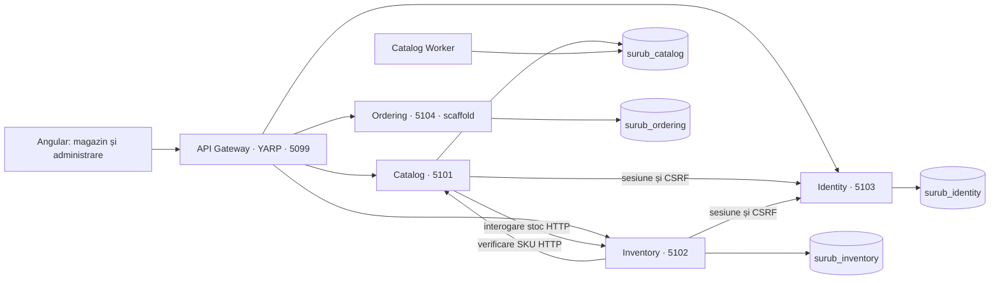

# Arhitectura cu servicii — 18 octombrie 2026

Decizia proprietarului: servicii separate cu API Gateway. Înlocuiește arhitectura de monolit modular din `archive/`.

## Limite și proprietatea datelor

| Serviciu | Responsabilitate implementată | Bază / scheme |
|---|---|---|
| Catalog | Categorii, atribute tehnice, produse, variante, oferte, prețuri, publicare, compunerea catalogului cu disponibilitatea primită prin HTTP | `surub_catalog`: catalog, pricing |
| Inventory | Recepții idempotente, sold și interogare stoc; verifică existența SKU prin Catalog | `surub_inventory`: inventory |
| Identity | ASP.NET Identity, autentificare, rol Administrator, cookie și CSRF | `surub_identity`: identity |
| Ordering | Proces independent cu health checks și capabilități; checkout dezactivat | `surub_ordering`: încă fără tabele comerciale |
| Gateway | Rutare explicită, limitare trafic; fără baze sau referințe la serviciile comerciale | — |

Fiecare bază are utilizator propriu, fără drept de conectare la bazele celorlalte servicii. Instanța PostgreSQL locală este comună pentru economie de resurse; separarea este la nivel de baze și permisiuni. Se pot muta pe instanțe separate fără schimbări în domeniu.

Pricing rămâne parte a serviciului Catalog. Proiectele Pricing separate reprezintă organizarea internă și păstrează migrațiile existente, nu un serviciu suplimentar. Store.Application este compoziția internă a Catalogului: nu mai încarcă infrastructura Inventory. Ordering nu conține încă Domain/Application/Infrastructure goale; straturile vor fi introduse odată cu regulile comerciale reale.

## Comunicarea și erorile

Catalog folosește portul propriu `IStockReader`, implementat de un client HTTP către Inventory. Inventory folosește `IVariantLookup`, implementat prin HTTP către Catalog. Nu există referințe între proiectele celor două servicii. Testele de arhitectură verifică această limită.

Endpoint-urile `/internal` sunt protejate cu credențiale de serviciu și nu au rute în gateway. Local, toate API-urile ascultă numai pe loopback. Clienții au timeout de cinci secunde, nu urmează redirectări și nu stochează cookie-uri. Un serviciu indisponibil produce 503; nu transformăm eroarea în stoc zero sau „SKU inexistent”. Nu repetăm automat cereri de scriere.

Catalog depinde momentan de Inventory pentru răspunsul agregat al paginii; o indisponibilitate Inventory face temporar indisponibilă acea interogare. O proiecție locală de disponibilitate poate elimina această dependență ulterior, cu un contract explicit de consistență eventuală. Verificarea SKU la recepție nu este o tranzacție distribuită; înainte de introducerea ștergerii/arhivării trebuie definită politica pentru variantele deja referite.

## Autentificare și protecția modificărilor

Browserul folosește aceeași origine și un cookie HttpOnly; nu stochează tokenuri în localStorage. Gateway-ul trimite `/api/auth` către Identity. Catalog și Inventory verifică fiecare cerere administrativă la endpoint-ul intern Identity. Pentru POST/PUT/etc., Identity verifică și tokenul CSRF în contextul utilizatorului. Serviciul aplică apoi politica de rol Administrator. Aceleași reguli se aplică accesului direct la portul serviciului.

Acesta este un mecanism de validare la distanță a sesiunii existente, nu un server OAuth/OIDC și nu o implementare JWT proprie. Are costul unui apel Identity per cerere administrativă și refuză operația când Identity nu este disponibil. Gateway-ul nu este unica limită de autorizare și nu deține cheile cookie-urilor. Pentru producție sunt necesare TLS între servicii, management/rotație de secrete, chei Data Protection persistente pentru Identity și, dacă apar aplicații terțe, un furnizor OIDC dedicat.

## Evenimente și RabbitMQ

Outbox și jurnalul local de publicare aparțin exclusiv Catalogului. Worker-ul are acces doar la baza Catalog. În această reorganizare nu există încă un consumator comercial de evenimente între servicii, deci RabbitMQ nu este instalat și nu pretindem că jurnalul actual este un message bus.

La implementarea comenzilor: Ordering păstrează snapshot-ul prețurilor, Inventory efectuează rezervarea atomică, iar RabbitMQ transportă evenimentele cu Outbox, confirmări de publicare, Inbox/deduplicare, retry limitat și dead-letter. Checkout-ul nu se activează înainte de această implementare și de definirea compensărilor.

## Date existente și revenire

`migrate-legacy` copiază schemele numai în baze țintă fără tabele. Verifică numărul de rânduri al fiecărui tabel și păstrează dump-uri private în `work/backups`. Nu suprascrie ținte inițializate și nu șterge sursa. API-ul vechi trebuie oprit înainte de copiere.

Baza `surub_direct` rămâne o copie de recuperare. După apariția de scrieri noi în servicii, revenirea la această copie ar pierde modificările ulterioare; nu este o procedură automată de rollback. Arhiva surselor anterioare se găsește în `work/before-microservices.tar.gz` pe acest calculator.

## Deployment

Fiecare API și worker se compilează/publică separat cu `dotnet publish <proiect>`. Gateway-ul nu depinde de DLL-urile serviciilor. Local, `scripts/dev.py up` orchestrează procesele; nu este orchestrator de producție. Configurează `ConnectionStrings__Catalog/Inventory/Identity/Ordering`, adresele `Services__*`, cheile `ServiceKeys__*` și destinațiile YARP separat pentru fiecare proces. Nu trimite configurația completă `.env` către toate serviciile.

YARP este configurat prin [mecanismul oficial de rute și clustere](https://learn.microsoft.com/aspnet/core/fundamentals/servers/yarp/config-files).

## Taxonomia Catalogului — 19 octombrie 2026

Categoriile, legăturile categorie–atribut și valorile SKU aparțin exclusiv Catalogului. Produsul referă categoria prin ID; câmpul text vechi rămâne snapshot pentru compatibilitate. Citirile folosesc numele categoriei actuale. Clienții vechi pot încă trimite un nume de categorie, care este rezolvat sau creează o rădăcină; interfețele noi transmit ID-ul.

Moștenirea reunește atributele strămoșilor fără duplicate. Categoriile fără produse publicate sunt ascunse public, cu excepția strămoșilor necesari arborelui. Filtrele categoriei includ produsele descendenților; toate condițiile tehnice trebuie îndeplinite de aceeași variantă. Fără categorie, API-ul acceptă filtrele caracteristicilor de bază. Valorile atributelor inactive se păstrează și redevin vizibile la reatribuire; nu sunt fabricate valori comerciale în migrare.

Modificarea taxonomiei și salvarea valorilor se fac într-o tranzacție Catalog cu blocare PostgreSQL a tabelului Categories, împiedicând cicluri și schimbări simultane ale definițiilor aplicabile în timpul salvării. Aceasta este o soluție inițială conservatoare pentru volumul redus al administrării; nu reprezintă control optimist al tuturor editărilor de produse.

## Stocarea imaginilor — 19 octombrie 2026

Catalog deține metadatele imaginilor și accesul la fișiere. `Media__Root` configurează un director privat persistent, separat de web root; scriptul local îl setează la `work/media/catalog`. Publicarea serviciului pe alt calculator necesită configurarea acestui director și backup pentru el împreună cu baza Catalog. `IImageStorage` permite ulterior un adaptor de object storage fără dependențe noi în Domain/Application. Adaptorul actual nu este o soluție pentru mai multe instanțe fără un volum comun.

Upload-ul transmite corp binar, cu text alternativ și SKU opțional în query, iar cookie-ul și antetul CSRF se validează înainte de endpoint. Nu sunt folosite numele fișierelor ca nume pe disc. Procesorul verifică formatul prin decodare, limitează dimensiunea/pixelii, aplică orientarea EXIF și reencodează rasterul în două WebP; originalul și metadatele EXIF nu sunt păstrate. [SkiaSharp](https://www.nuget.org/packages/SkiaSharp/4.153.1) este dependența tehnică a Infrastructure, împreună cu pachetul nativ Linux.

Mutările galeriei blochează rândul produsului în PostgreSQL, pentru a serializa încărcările, ordinea și imaginea principală. Fișierele sunt scrise înainte de commit-ul metadatelor. Dacă acel commit eșuează, fișierele pot rămâne orfane; nu le ștergem automat într-un rezultat de commit incert. Eliminarea salvează mai întâi metadatele și apoi încearcă ștergerea fizică; erorile de filesystem sunt jurnalizate pentru curățare. Fișierele nereferențiate nu sunt servite. Aceasta nu este o tranzacție distribuită între bază și filesystem.

Citirea publică este permisă numai produselor publicate; citirea administrativă cere rol Administrator și include ciorne/arhivate. Răspunsurile sunt `image/webp`, `nosniff`, `Cache-Control: no-store`, astfel încât arhivarea să închidă accesul la cererile ulterioare fără un cache public care să păstreze imaginea. Copiile deja descărcate nu pot fi retrase. Rutele intră în regulile existente `/api/v1/products/**` și `/api/v1/admin/products/**` ale gateway-ului.
